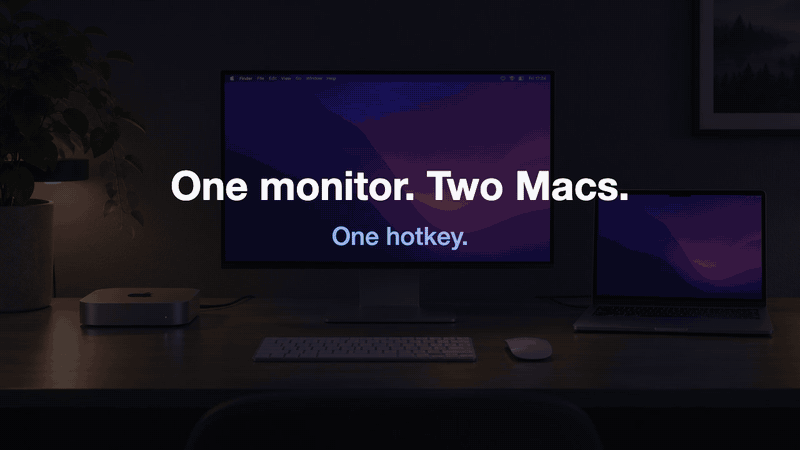

# monitor-switch

**Share one monitor, keyboard and mouse between two Macs.** Press
**Control+Enter** and all three move to the other Mac in about 10 seconds.

<p align="center"><a href="docs/demo.mp4"></a><br>
<sub><a href="docs/demo.mp4">Watch the MP4</a></sub></p>

- Both Macs stay plugged into the same monitor, each on its own input.
- The monitor changes its input, and the keyboard and mouse pair with the
  other Mac.
- No KVM switch, no cables to move, nothing to buy.

**You need:** a Mac mini on the monitor's HDMI input and a MacBook on its
DisplayPort input, both on the same home network, and a Bluetooth Magic
Keyboard and Magic Mouse.

## Install

Before you start:

1. Pair the keyboard and mouse with the Mac you install from.
2. In the monitor's menu set **Input Select** to **Auto**.
3. On the **other** Mac turn on **Remote Login** (System Settings → General →
   Sharing). It is needed only while installing.

### With Homebrew

On either Mac:

```sh
brew install danijar2000/tap/monitor-switch
monitor-switch setup
```

Homebrew is needed only on the Mac you run this on: `monitor-switch setup`
installs on both Macs.

### Without Homebrew

On either Mac:

```sh
curl -fsSL https://github.com/danijar2000/monitor-switch/releases/latest/download/get.sh | zsh
```

### Then

The installer finds the other Mac and the devices, asks what it is unsure
of, and sets up both Macs. When macOS asks whether **monitor-switch** may use
**Bluetooth** and the **local network**, click **Allow** on each Mac. After
every update macOS asks about Bluetooth again.

| | With Homebrew | Without Homebrew |
|---|---|---|
| **Update** | `brew upgrade monitor-switch && monitor-switch setup` | run the `curl` line again |
| **Change settings** | edit `~/.monitor-switch/installer/install.conf`, then `monitor-switch setup` | the same |
| **Uninstall** | `monitor-switch setup uninstall && brew uninstall monitor-switch` | `~/bin/monitor-switch setup uninstall` |

`setup uninstall --purge` also deletes the settings and logs.

## Use

Press **Control+Enter** on either Mac. A panel in the corner shows the
progress, the charge of the keyboard and mouse, and what went wrong if
something did.

**Control+Shift+Enter** moves only the monitor to the other Mac, and back:
the keyboard and mouse stay where they are.

The icon in the menu bar shows which Mac has the monitor, the keyboard and
the mouse, and does both switches with a click. It is dimmed while the
keyboard and mouse are on the other Mac.

```sh
~/bin/monitor-switch status    # what this Mac holds
~/bin/monitor-switch overview  # where everything is, on both Macs
~/bin/monitor-switch reach     # can this Mac's agent reach the other one?
tail -f ~/.monitor-switch/agent.log
```

Change the hotkeys (on each Mac); `off` in `hotkey-monitor` turns that one
off:

```sh
echo ctrl+alt+cmd+m > ~/.monitor-switch/hotkey
echo ctrl+alt+cmd+n > ~/.monitor-switch/hotkey-monitor
launchctl kickstart -k gui/$(id -u)/local.monitor-switch-hotkey
```

## Troubleshooting

- **"No route to host":** allow **monitor-switch** in System Settings →
  Privacy & Security → Local Network, then run `~/bin/monitor-switch reach`.
- **"refused: bad signature":** the Macs have different secrets; run the
  installer again.
- **The mouse stays on the old Mac:** press the hotkey again. If it is on
  neither Mac, connect it by cable for ten seconds.

## How it works

A background agent on each Mac does the Bluetooth work and talks to the
other Mac's agent over HTTP on the home network (port 47811). Every call is
signed with a secret both Macs share. The Mac giving up the devices unpairs
them, and the other Mac pairs them; anything it fails to get is taken back.
The monitor follows the active signal (Input Select = Auto).

The Mac mini keeps the monitor with the keyboard and mouse. When a Mac puts
its display to sleep, the monitor moves to the other input by itself and
does not come back. So the Mac mini calls the monitor back when it wakes up
holding the devices, and puts its own display to sleep when the monitor
shows it while the devices are on the MacBook. To look at the other Mac on
purpose, use **Control+Shift+Enter**, not the monitor's buttons.

## Development

```sh
cargo test
cargo clippy --all-targets -- -D warnings
./install.sh    # build from source and install on both Macs
```
